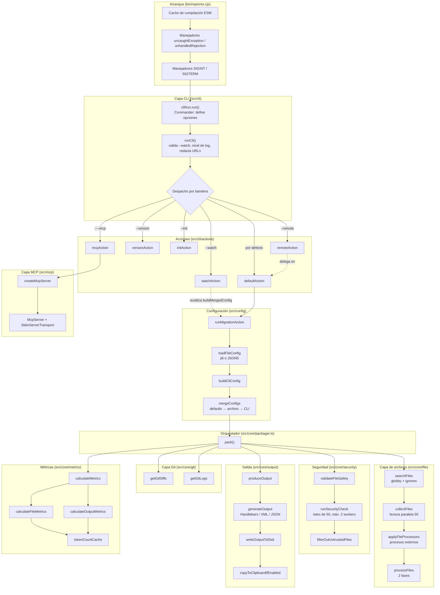

# Arquitectura de Repomix

Documento técnico de referencia sobre la arquitectura interna de Repomix, elaborado a partir de la
lectura directa del código fuente del proyecto.

- **Proyecto:** Repomix
- **Versión declarada:** `1.18.1` (`package.json`)
- **Commit documentado:** `0b3f82b4`
- **Licencia:** MIT — obra original de [yamadashy/repomix](https://github.com/yamadashy/repomix)
- **Autoría de este documento:** `DAW1BSergiomg26` (manteka-repomix)

---

## 1. Propósito y alcance

Repomix es una herramienta de línea de comandos que empaqueta un repositorio completo en un único
archivo legible por modelos de lenguaje. Este documento explica **cómo está organizado el código, qué
responsabilidad tiene cada capa y en qué orden se ejecuta el flujo de empaquetado**, incluyendo el
servidor MCP y la API pública para uso como librería.

Este documento **no** sustituye a la documentación de usuario del proyecto, sino que describe la
arquitectura interna con precisión, citando cada archivo y símbolo relevante.

---

## 2. Vista general de la arquitectura

Repomix es una aplicación Node.js escrita en TypeScript con módulos ESM. Su diseño se apoya en
cuatro principios observables en el código:

1. **Composición por dependencia de datos, no herencia.** Existe un único orquestador (`pack`) que
   coordina módulos funcionales independientes. Casi todas las funciones reciben sus colaboradores
   como parámetros `deps`, lo que permite sustituirlos en pruebas sin *mocks* de módulos.
2. **Inyección de dependencias explícita en todo el núcleo.** `pack` acepta un `overrideDeps` que
   sustituye cualquier etapa; `runSecurityCheck`, `validateFileSafety` y `processFiles` siguen el
   mismo patrón. Esto hace que todo el pipeline sea testeable de forma unitaria.
3. **Concurrencia como diseño, no como optimización posterior.** Las etapas independientes se
   ejecutan con `Promise.all`, y el trabajo pesado se delega a procesos *worker* gestionados por un
   pool propio basado en `Tinypool`.
4. **Carga perezosa de los módulos no críticos.** Las acciones de la CLI, el *skill generator* y
   parsers pesados se importan dinámicamente (`await import(...)`) solo cuando la funcionalidad se usa.

### 2.1 Capas del sistema

| Capa | Ubicación | Responsabilidad |
| --- | --- | --- |
| Arranque | `bin/repomix.cjs` | Punto de entrada ejecutable; manejadores de errores y señales |
| CLI | `src/cli/` | Parseo de argumentos, despacho de acciones, validación, reporte de resultados |
| Configuración | `src/config/` | Carga, validación y fusión de configuración (archivo, global, CLI) |
| Núcleo de empaquetado | `src/core/packager.ts` | Orquestador del pipeline completo |
| Archivos | `src/core/file/` | Búsqueda, lectura, procesado y transformación del contenido |
| Seguridad | `src/core/security/` | Detección de secretos y filtrado de archivos sospechosos |
| Salida | `src/core/output/`, `src/core/packager/produceOutput.ts` | Renderizado, división y escritura del resultado |
| Métricas | `src/core/metrics/` | Conteo de caracteres y tokens con caché en disco |
| Git | `src/core/git/` | Lectura de *diffs* y *logs* mediante subprocesos |
| MCP | `src/mcp/` | Servidor Model Context Protocol con registro selectivo de herramientas |
| Compartido | `src/shared/` | Pools de *workers*, logging, errores, utilidades de concurrencia |
| API pública | `src/index.ts` | Superficie exportada para consumo como paquete de librería |

---

## 3. Flujo principal de empaquetado

### 3.1 Diagrama general



### 3.2 El pipeline de `pack()` paso a paso

`pack(rootDirs, config, progressCallback, overrideDeps, explicitFiles, options)` es el corazón del
sistema. Su secuencia real, con los solapamientos de concurrencia que el propio código documenta, es:

| # | Paso | Descripción |
| --- | --- | --- |
| 1 | Carga diferida de la caché de tokens | `loadTokenCountCache()` se lanza sin `await` para que se solape con búsqueda y lectura |
| 2 | Precarga de datos de ordenación | `prefetchSortData(config)` en segundo plano, con captura de errores |
| 3 | Búsqueda de archivos | `searchFiles` en paralelo para cada directorio raíz, envuelto en `withMemoryLogging` |
| 4 | Ordenación y rutas de presentación | Deduplicación con `Set`, `sortPaths` y conversión a rutas visibles según `output.filePathStyle` |
| 5 | Precarga del pool de métricas | `createMetricsTaskRunner` inicializa el pool y dispara el calentamiento de *workers* |
| 6 | Lectura, processors y Git en paralelo | `Promise.all` con tres ramas: `collectFiles` + `applyFileProcessors` por raíz, `getGitDiffs` y `getGitLogs` |
| 7 | Niveles de inclusión y rutas finales | Cada archivo recibe su `level` resuelto contra la ruta relativa a la raíz, antes de reescribir `path` |
| 8 | Seguridad y procesado en paralelo | `Promise.all` con `validateFileSafety` (pool de *workers*) y `processFiles` (pool o proceso principal) |
| 9 | Filtrado de sospechosos | Se descartan de `processedFiles` los archivos marcados por el análisis de secretos |
| 10 | Orden final | `await sortDataPromise` y `sortOutputFiles` dejan los archivos en el orden exacto del futuro *output* |
| 11 | Cortocircuito en modo *skill* | Si hay `skillGenerate` y `skillDir`, `packSkill` devuelve el resultado y omite métricas y salida |
| 12 | Salida y métricas solapadas | `Promise.all` con `produceOutput` y `calculateMetrics`, que recibe esa misma promesa del *output* |
| 13 | Persistencia de la caché | `saveTokenCountCache(rootDirs)` con escritura atómica, y `finally` que limpia el pool |

> **Nota sobre el orden de las capas.** La salida y las métricas no se ejecutan en serie: el código
> arranca `produceOutput` y le entrega esa misma promesa a `calculateMetrics`, que a su vez inicia el
> conteo por archivo, el de *diffs* y el de *logs* antes de esperar al *output*. El solapamiento es
> deliberado y está justificado en los comentarios del código: las métricas por archivo no dependen
> del *output*, solo las métricas del *wrapper* sí.

---

## 4. Arranque y puntos de entrada

### 4.1 `bin/repomix.cjs`

Es un archivo CommonJS ejecutado por Node. Antes de cargar nada del proyecto:

- Activa `module.enableCompileCache()` y propaga el directorio mediante la variable
  `NODE_COMPILE_CACHE`, de modo que los *workers* spawned hereden la caché. El comentario del código
  advierte que la propagación debe ocurrir **antes** de que se cargue cualquier módulo, algo crítico
  para los *imports* ESM estáticos.
- Advierte si la versión de Node es anterior a la 20, sin impedir la ejecución.
- Instala manejadores de `uncaughtException` y `unhandledRejection` que registran el error y terminan
  con código `1`, y manejadores de `SIGINT`/`SIGTERM` que terminan con código `0`.
- Importa dinámicamente `../lib/cli/cliRun.js` y llama a `run()`. La ruta `lib` confirma que el
  proyecto se distribuye compilado a JavaScript.

### 4.2 API pública (`src/index.ts`)

El paquete exporta una superficie pensada para uso como librería. Entre los símbolos más relevantes:

- **Núcleo:** `pack`, `PackResult`.
- **Archivos:** `collectFiles`, `sortPaths`, `processFiles`, `searchFiles`, `generateFileTree`,
  `generateTreeString`, `treeToString`.
- **Seguridad:** `runSecurityCheck`, `SuspiciousFileResult`.
- **Configuración:** `loadFileConfig`, `mergeConfigs`, `defineConfig`, `defaultIgnoreList`.
- **Métricas y *tree-sitter*:** `TokenCounter`, `parseFile`, `setWasmBasePath`.
- **CLI reutilizable:** `cli`, `runCli`, `runDefaultAction`, `buildCliConfig`, `runRemoteAction`,
  `runInitAction`.
- **Worker unificado:** `unifiedWorkerHandler`, `unifiedWorkerTermination`, `WorkerType`.

---

## 5. Capa CLI

### 5.1 `cliRun.run()`

Construye el programa de Commander con el conjunto completo de opciones, incluidas las variantes
`--no-*` (necesarias para que el valor por defecto de Commander no pise la configuración de archivo)
y el `commanderActionEndpoint` que entrega las opciones ya parseadas al resto del flujo.

### 5.2 `runCli(directories, cwd, options)`

Es el despachador central. Su orden de decisiones es significativo:

1. Normaliza el modo *stdout* implícito (`--output -`).
2. Valida los conflictos de `--watch` **antes** de cambiar el nivel de log, para que el error no quede
   silenciado.
3. Fija el nivel de log: `SILENT` con `--quiet` o `--stdout`, `DEBUG` con `--verbose`, `INFO` por
   defecto.
4. Redacta URLs y opciones sensibles en cualquier traza (`redactUrl`, `redactOptionsForLog`).
5. Enruta por bandera, con importaciones dinámicas para no cargar lo que no se usa:
   `--mcp`, `--version`, `--init`, `--remote`, `--watch` y, como último recurso,
   `defaultAction`.
6. Detecta repositorios remotos en los argumentos posicionales: URL explícita (`https://`, `git@`,
   `ssh://`, `git://`) y forma abreviada `owner/repo`. La forma abreviada solo se acepta si la ruta
   **no existe localmente** y un sondeo `git ls-remote` confirma que el repositorio es alcanzable,
   evitando que una ruta local mal escrita provoque un clonado no intencionado.
7. Omite el banner de versión en modo `--stdin` para no corromper la salida canalizada de
   herramientas interactivas como `fzf`.

### 5.3 `defaultAction`

Es la acción por defecto y concentra la construcción de la configuración:

- `buildMergedConfig(cwd, cliOptions)`: ejecuta migraciones pendientes, carga el archivo de
  configuración, convierte las opciones de CLI en configuración y fusiona las tres fuentes.
- Valida conflictos entre `--split-output`, `--skill-generate`, `--stdout` y `--copy`, además de las
  dependencias de las opciones de *skill*.
- En modo *skill*, resuelve el directorio de destino de forma no interactiva o mediante un diálogo interactivo.
- En modo `--stdin` exige que no se pasen directorios posicionales y lee la lista de rutas desde la
  entrada estándar.
- Ejecuta `pack` **en el proceso principal**, no en un hijo. El comentario del código registra el
  motivo: el proceso hijo costaba unos 250 ms de arranque y recarga de módulos sin aportar nada, ya
  que el *spinner* y el *pack* corrían igualmente dentro de ese hijo.
- Muestra el progreso con un `Spinner` y, al terminar, invoca `reportResults`.
- Aplica `validateTokenBudget` como último paso. Al ejecutarse después de que la salida ya se ha
  escrito, actúa como guarda que termina con código distinto de cero, no como un fallo temprano. Las
  ejecuciones remotas aplazan esta comprobación para poder copiar la salida del directorio temporal
  antes de que la guarda lance.

---

## 6. Capa de configuración

### 6.1 Carga (`configLoad.ts`)

El orden de prioridad de nombres de archivo, compartido por la carga y por la resolución de rutas, es:

```
repomix.config.ts
repomix.config.mts
repomix.config.cts
repomix.config.js
repomix.config.mjs
repomix.config.cjs
repomix.config.json5
repomix.config.jsonc
repomix.config.json
```

- Un `--config` explícito se respeta siempre; si el archivo no existe, es un error.
- Sin `--config`, se busca primero un archivo local; si existe pero `skipLocalConfig` está activo se
  omite y se informa de que se puede usar `--remote-trust-config` para cargarlo.
- Solo si no hay configuración local se busca la global, en el directorio global del sistema, y
  `skipGlobalConfig` la suprime.
- Las extensiones ejecutables (`ts`, `mts`, `cts`, `js`, `mjs`, `cjs`) se cargan con **jiti**, que se
  importa de forma perezosa para no arrastrar el *toolchain* de TypeScript cuando la configuración es
  JSON o inexistente. `moduleCache: false` garantiza lecturas frescas, y el envoltorio
  `{ default }` del *namespace* ESM se desenvuelve solo cuando su valor es un objeto.
- `json5`, `jsonc` y `json` se analizan con JSON5.
- El resultado se valida siempre contra `repomixConfigFileSchema` (Valibot), y los errores de esquema
  se re-lanzan como `RepomixError` con un mensaje específico.

La función `isExecutableConfigPath` expone exactamente el conjunto de extensiones que se ejecutan al
cargar, y la usa el aviso de confianza de repositorios remotos para advertir de que la configuración
es ejecutable.

### 6.2 Fusión (`mergeConfigs`)

La precedencia es **valores por defecto → archivo de configuración → opciones de CLI**, con tres
matices importantes:

- `include` y `ignore.customPatterns` se **concatenan** en lugar de sobrescribirse, de modo que las
  tres fuentes acumulan patrones.
- `output.git` se fusiona en profundidad, campo por campo, para no perder subajustes de niveles
  inferiores.
- Si `output.filePath` no se fijó explícitamente, se ajusta automáticamente a la extensión que
  corresponde al estilo elegido mediante `defaultFilePathMap`.
- `skillGenerate` y `enableFileProcessors` solo pueden provenir de la CLI, nunca de un archivo de
  configuración: el segundo ejecuta comandos arbitrarios y no puede activarse desde datos.

### 6.3 Esquemas y valores por defecto (`configSchema.ts`)

Valibot define los esquemas de archivo, de CLI y fusionado, y `defaultConfig` fija los valores
iniciales relevantes: estilo `xml`, resumen, estructura de directorios y contenido de archivos
habilitados, `removeComments` y `compress` desactivados, comprobación de seguridad activada y
codificación de recuento `o200k_base`.

---

## 7. Capa de archivos

### 7.1 Búsqueda (`fileSearch.ts`)

`searchFiles` es deliberadamente estricto en las primeras fases, porque un error de permisos aquí
produce un resultado vacío e incomprensible más adelante:

1. `fs.stat` distingue inexistente (`ENOENT`), sin permisos (`EPERM`/`EACCES`) y otros fallos, cada
   uno con su propio tipo de error.
2. Verifica que la ruta sea un directorio, no un archivo.
3. Ejecuta una comprobación explícita de permisos de lectura.
4. Construye el contexto de exclusiones combinando `.gitignore`, `.ignore` y `.repomixignore`, y
   distingue patrones que globby puede resolver de los que se aplazan para un filtrado posterior.
5. Escapa los caracteres especiales de los patrones glob y normaliza las barras finales, de modo que
   `**/folder`, `**/folder/` y `**/folder/**` se comporten igual.
6. En modo `--stdin`, los archivos explícitos se convierten en patrones de inclusión adicionales.
7. Si no hay ningún patrón de inclusión, se usa `**/*`.
8. Ejecuta globby. Con `includeEmptyDirectories` activa, hace **una sola travesía** en modo
   `objectMode` y separa archivos y directorios por el tipo de entrada, en lugar de recorrer el árbol
   dos veces; la búsqueda de directorios vacíos usa concurrencia 20.
9. Aplica un filtro de seguridad opcional (`confineToBaseDir`) que canonicaliza cada ruta con
   `realpath` y descarta todo lo que resuelva fuera de la raíz. El comentario del código explica que
   un *glob* puede producir rutas fuera del directorio base aunque el llamador haya acotado los
   patrones, y que comparar *realpaths* —no rutas léxicas— también cubre el caso de un enlace
   simbólico intermedio.
10. Devuelve rutas de archivos y directorios vacíos ordenados.

### 7.2 Lectura (`fileCollect.ts`)

Lee el contenido de los archivos con un *pool* de promesas de concurrencia **50**. Además registra la
información de los archivos omitidos (`skippedFiles`): los archivos que quedan fuera del resultado no
desaparecen sin más, se difunden hacia el llamante para que el usuario sepa exactamente qué se dejó
fuera y por qué.

### 7.3 Procesadores de archivos (`fileProcessorRun.ts`)

`applyFileProcessors` ejecuta los procesadores externos declarados en `input.processors`, que se
ajustan por patrón glob como `include` e `ignore`. Sus propiedades relevantes:

- **Puerta de seguridad:** solo se ejecutan si `config.enableFileProcessors` está activo, un valor
  que únicamente puede establecer el punto de entrada real de la CLI. Los consumidores de librería,
  el servidor MCP y el sitio web alojado lo mantienen apagado.
- `logFileProcessorStatus` comunica en cada ejecución si hay procesadores activos o si están
  configurados pero desactivados, porque ejecutan comandos arbitrarios.
- Timeout de 60 s por proceso, búfer de salida máximo de 64 MiB y un *semáforo* de procesos
  simultáneos limitado a `min(8, cpus)`.
- Los patrones se validan antes de ejecutar nada, y un fallo previo invalida el resto del lote sin
  lanzar nuevos procesos.

### 7.4 Procesado (`fileProcess.ts`)

`processFiles` implementa un pipeline de dos fases explícitamente diseñado para no pagar el coste de
los *workers* cuando no hace falta:

1. **Resolución de niveles.** Cada archivo recibe un nivel de inclusión resuelto contra su ruta
   relativa a la raíz. Los tres niveles posibles son `full`, `compress` y `directory-only`; este
   último se descarta del contenido de salida, aunque su ruta siga apareciendo en el árbol de
   directorios, que se construye a partir de los resultados de búsqueda y no de los archivos procesados.
2. **Fase pesada (solo si hace falta).** El orden interno es `removeComments` → `compress` —este
   último basado en *tree-sitter*— y ambos se ejecutan en el pool de *workers*. La decisión de usar el
   pool no depende solo de la bandera global `compress`, sino de si **algún** archivo resuelve al nivel
   `compress` o se pidieron comentarios eliminados; en caso contrario la fase se omite por completo.
3. **Fase ligera (proceso principal, siempre).** El orden es deliberado y está documentado en el
   código: `truncateBase64` → `removeEmptyLines` → `trim` → `showLineNumbers`. `removeEmptyLines`
   actúa después de `removeComments` para limpiar las líneas vacías que este genera. Los números de
   línea se suprimen para archivos comprimidos, porque su contenido son firmas reestructuradas y no
   fuente fiel a las líneas.

---

## 8. Capa de seguridad

### 8.1 Análisis (`securityCheck.ts` y el worker)

`runSecurityCheck` construye una lista heterogénea de elementos a analizar: todos los archivos
recopilados más, opcionalmente, los *diffs* del árbol de trabajo y del *staging* y el contenido del
*log* de Git. Cada elemento se etiqueta con su tipo (`file`, `gitDiff`, `gitLog`).

- **Lotes de 50 elementos** por tarea. El comentario del código justifica la decisión con un
  argumento concreto: el análisis siempre procesa todos los archivos del repositorio, así que un
  lote de 50 ya produce alrededor de 20 lotes, suficientes para repartir entre los núcleos disponibles,
  y agrupar reduce el coste de ida y vuelta de la IPC.
- **Máximo de 2 hilos.** El límite es deliberado y está razonado en el código: se trata de reducir la
  contención con el pool de métricas, que corre en paralelo, y como el análisis usa lotes gruesos,
  dos hilos bastan incluso para un repositorio de 1000 archivos.
- El análisis real lo hace **secretlint** con el *preset* recomendado
  (`@secretlint/secretlint-rule-preset-recommend`), que detecta formatos de secretos conocidos.
- **Los mensajes detectados nunca se registran en el log**, solo su cantidad y la ruta, para no filtrar
  el secreto que se acaba de encontrar.
- El *worker* incorpora una optimización que desactiva `performance.mark` mediante
  `Object.defineProperty`. El razonamiento está extenso y bien argumentado en el código: el profiler
  de secretlint es un *singleton* de nivel de módulo que instala un `PerformanceObserver` global y
  empuja una entrada por marca en un arreglo no acotado; cada marca entrante ejecuta un
  `entries.find()` O(n) sobre todas las anteriores, de modo que el coste total del profiler a lo
  largo de la vida de un *worker* es O(n²) en el número de archivos procesados. Para un repositorio
  típico de ~1000 archivos son **~1,2 s de contabilidad pura por *worker*** sin ningún beneficio
  funcional, porque `@secretlint/core` solo escribe marcas y nunca las vuelve a leer.
- Se parchea `performance.mark` en lugar del *singleton* del profiler por una razón concreta: cuando
  la versión declarada como *peer dependency* se desvía de la resuelta en el nivel superior, npm anida
  una segunda copia y el *singleton* que `@secretlint/core` invoca ya no es el importado. Todas las
  copias comparten el mismo objeto `perf_hooks.performance`, por lo que sustituir el método neutraliza
  a todas a la vez, sin depender del *layout* de módulos.
- La asignación crea una propiedad propia sobre la instancia que **sombrea**
  `Performance.prototype.mark`, dejando el prototipo intacto para no afectar a ninguna otra instancia
  de `Performance`, y va envuelta en un `try/catch` que toleraría que una versión futura de Node la
  hiciese no configurable.
- Todo ello está protegido por `isMainThread` porque el mismo módulo se importa también en
  `src/mcp/tools/fileSystemReadFileTool.ts`, que corre en el proceso principal del servidor MCP.
  Aplicar el parche allí desactivaría `performance.mark` en todo el proceso; en ese camino solo se
  analizan unos pocos archivos por llamada, así que el coste del profiler es imperceptible.

### 8.2 Validación (`validateFileSafety.ts`)

`validateFileSafety` orquesta el análisis y sus consecuencias:

- Solo se ejecuta si `security.enableSecurityCheck` está activo.
- Separa los resultados por tipo: archivos, *diffs* y *logs*.
- **Los *diffs* y *logs* sospechosos se incluyen igualmente en la salida**, con una advertencia
  explícita, mientras que los archivos sospechosos se excluyen del empaquetado. El motivo es que un
  *diff* o un *log* son fragmentos de contexto cuya eliminación silenciosa perdería información
  relevante sobre la revisión.
- `filterOutUntrustedFiles` produce el conjunto final de archivos seguros y sus rutas.

En `pack`, los archivos ya procesados se vuelven a filtrar por el conjunto de rutas sospechosas antes
de generar la salida, de modo que ninguna ruta sospechosa llega al *output*.

---

## 9. Capa de salida

### 9.1 `produceOutput`

Decide entre dos caminos según `output.splitOutput`:

- **Salida dividida:** `generateSplitOutputParts` produce las partes respetando el tamaño máximo y
  cada una se escribe con `stdout` forzado a `false`, porque el modo *split* exige escribir en disco
  y es incompatible con `--stdout` y con el portapapeles.
- **Salida única:** `generateOutput` → `writeOutputToDisk` → `copyToClipboardIfEnabled`, en ese orden.

Todas las fases se envuelven en `withMemoryLogging`, que registra el consumo de memoria por etapa.

### 9.2 `outputGenerate.ts`

El renderizado tiene dos caminos que se eligen según la configuración:

- **Plantillas Handlebars** para `xml`, `markdown` y `plain`, con una caché de plantillas compiladas
  para no recompilar en cada llamada. Cualquier otro estilo lanza un `RepomixError`.
- **Salida parseable**, construida con `fast-xml-builder` para XML y con un objeto plano para JSON.
  El import de `fast-xml-builder` es perezoso porque solo se usa en este modo no predeterminado.

El contexto de renderizado (`createRenderContext`) es un objeto único que las plantillas consumen: las
cabeceras, el resumen del archivo, la estructura del árbol, los archivos con su recuento de líneas, la
cabecera proporcionada por el usuario, las instrucciones y los bloques de Git.

Dos detalles de robustez en Markdown:

- **El delimitador del bloque de código se calcula dinámicamente.** Como la plantilla Markdown
  envuelve contenidos, árbol y *diffs* en el mismo bloque, el delimitador debe ser más largo que la
  secuencia de acentos graves más larga presente en cualquiera de esos contenidos; de lo contrario, un
  *diff* de un archivo Markdown con líneas de contexto ``` cerraría el bloque antes de tiempo y
  corrompería la salida.
- **El recuento de líneas distingue el salto final.** Un archivo vacío tiene 0 líneas; si el contenido
  termina en `\n`, ese salto final no cuenta como una línea adicional.

El contexto también calcula qué secciones están habilitadas: resumen, estructura de directorios,
archivos y los bloques de Git, todos gobernados por `output.*` y `output.git.*`.

---

## 10. Capa de métricas

### 10.1 `calculateMetrics`

Devuelve el agregado de `totalFiles`, `totalCharacters`, `totalTokens`, `fileCharCounts`,
`fileTokenCounts`, `gitDiffTokenCount` y `gitLogTokenCount`.

Su diseño se centra en un solapamiento deliberado: las métricas por archivo, del *diff* y del *log*
se lanzan **antes** de esperar al *output*, porque ninguno depende de él. Se adjuntan manejadores
vacíos de rechazo a esas promesas para que, si `await outputPromise` lanza primero, no se produzca
un rechazo sin manejar.

### 10.2 Ruta rápida y caché de tokens

Cuando la salida es única, no es parseable y el estilo es `xml`, `markdown` o `plain`, se aplica una
ruta rápida:

1. `extractOutputWrapper` recorre el *output* una sola vez buscando cada contenido de archivo en orden
   y concatena los segmentos intermedios, que son precisamente las cabeceras y la estructura del
   *template*.
2. Ese *wrapper* se tokeniza una única vez, con la misma caché en disco direccionada por contenido que
   los recuentos por archivo. El *wrapper* es estable entre ejecuciones mientras no cambien el conjunto
   de archivos, las cabeceras, las instrucciones o el formato, de modo que cualquier cambio produce
   un *fallo de caché* automáticamente.
3. El total es la suma de los tokens por archivo más los del *wrapper*.

Si el contenido de un archivo no aparece literalmente en la salida —porque la plantilla lo escapó,
porque hubo división o porque el orden difiere—, la función devuelve `null` y se recurre a la
tokenización completa de la salida. `canUseFastOutputTokenPath` desactiva la ruta rápida de forma
explícita para salida dividida, estilos parseables y estilos no textualmente localizables.

### 10.3 Caché y calentamiento

- La carga de la caché en disco arranca al principio de `pack` y se espera justo antes de calcular
  métricas; el código la describe como red de seguridad para máquinas rápidas.
- `createMetricsTaskRunner` implementa una predicción de temperatura con dos `existsSync`: si existen
  la caché global y el marcador de «ya visto» para este repositorio, la ejecución probablemente está
  «caliente» y basta calentar **un** *worker*; en caso contrario se calienta el pool completo. El
  propio código advierte que es un predictor de rendimiento, no una señal de corrección: un marcador
  obsoleto solo provoca la creación diferida de *workers*.
- El calentamiento existe porque el análisis BPE de `gpt-tokenizer` cuesta unos 225 ms y no debe caer
  en el camino crítico de las métricas.
- La caché se persiste al final con escritura atómica (escritura en temporal más `rename`) y traga
  sus errores de forma deliberada.

---

## 11. Capa Git

`getGitDiffs` y `getGitLogs` invocan Git como subproceso y se ejecutan en paralelo con la lectura de
archivos, porque son independientes. Sus resultados alimentan tres cosas: el contenido opcional del
*output*, el análisis de seguridad y las métricas de tokens correspondientes. Además, los recuentos de
cambio por archivo se cachean y se usan para ordenar la salida, lo que justifica la precarga de
datos de ordenación al principio de `pack`.

---

## 12. Capa MCP

### 12.1 Ciclo de vida

`createMcpServer` instancia un `McpServer` del SDK de Model Context Protocol, con la versión leída
del propio `package.json`, y elige el texto de instrucciones según el modo. `runMcpServer` conecta un
`StdioServerTransport` y registra manejadores de `SIGINT` y `SIGTERM` que cierran el servidor con
código `0` o `1` según el resultado.

### 12.2 Registro selectivo de herramientas

El registro depende del modo, y la razón está anotada en el código:

| Herramienta | Modo sandbox | Fuera de sandbox |
| --- | --- | --- |
| `pack_codebase` | Sí | Sí |
| `read_repomix_output` | Sí | Sí |
| `grep_repomix_output` | Sí | Sí |
| `file_system_read_file` | Sí | No |
| `file_system_read_directory` | Sí | No |
| `pack_remote_repository` (y su *prompt*) | No | Sí |
| `generate_skill` | No | Sí |
| `attach_packed_output` | No | Sí |

Las tres herramientas de lectura del sistema de archivos son exclusivas del modo *sandbox* porque
fuera de él pueden leer cualquier ruta accesible al proceso, y su análisis de secretos es una
heurística de contenido, no una frontera de acceso. En sentido inverso, el empaquetado remoto necesita
red, la generación de *skills* escribe en disco y `attach_packed_output` lee archivos externos de
ruta arbitraria, por lo que se deshabilitan bajo el modo *sandbox*.

El modo *sandbox* se activa con `--sandbox`, cuyo valor puede ser el directorio de trabajo que
confina al servidor. La raíz se canonicaliza al arrancar para que la guarda, la virtualización de
rutas y el saneado de errores coincidan con los mismos *realpaths*, y las rutas que se devuelven al
agente son relativas a la raíz para no filtrar rutas del anfitrión.

Un detalle de seguridad relevante: una salida incorporada con `attach_packed_output` se marca como
procedente de una ruta no confiable, y `read_repomix_output` y `grep_repomix_output` la someten a un
análisis de secretos **antes** de servirla. La necesidad es evidente: la herramienta permite leer un
`*output*` externo de ruta arbitraria, de modo que sin ese paso el contenido de terceros llegaría al
agente sin filtrar.

---

## 13. Concurrencia y pools de workers

`src/shared/processConcurrency.ts` es la pieza que sostiene casi todo el paralelismo del proyecto.

- **Tecnología:** `Tinypool`. El *runtime* por defecto es `child_process`, no `worker_threads`,
  aunque ambos están soportados por la misma API y el código los denomina *workers* en bloque.
- **Propagación de contexto:** `workerData` transporta `workerType` y el nivel de log. Como en el
  *runtime* `child_process` ese canal no es accesible directamente, el pool lo duplica además en
  variables de entorno (`REPOMIX_WORKER_TYPE`, `REPOMIX_LOG_LEVEL`) y propaga `FORCE_COLOR`, `TERM` y
  `COLUMNS` para que el *spinner* y los colores se comporten igual dentro de los procesos hijos.
- **Dimensionado:** mínimo 1 hilo; máximo `min(concurrencia del sistema, ceil(tareas / 100))`, con la
  constante `TASKS_PER_THREAD = 100` justificada en el propio código: inicializar un *worker* es
  caro, así que conviene usar pocos hilos salvo que haya muchas tareas. La concurrencia del sistema se
  obtiene de `os.availableParallelism()`, con respaldo a `os.cpus().length`.
- **Límite opcional:** `maxWorkerThreads` permite capar un pool, y es lo que usa el análisis de
  seguridad para limitarse a dos.
- **Ciclo de vida:** `idleTimeout` de 5000 ms y `teardown: 'onWorkerTermination'`.
- **Entornos empaquetados:** si está definida `REPOMIX_WORKER_PATH`, todos los tipos usan un único
  *worker* unificado en lugar de un archivo por tipo.
- **Aislamiento de dependencias:** en el modo normal, cada tipo de tarea tiene su propio archivo
  (`fileProcessWorker.js`, `securityCheckWorker.js`, `calculateMetricsWorker.js`), seleccionado por
  el campo `workerType`.
- **Adaptación a Bun:** `cleanupWorkerPool` detecta `process.versions.bun` porque en ese runtime el
  método `destroy` de Tinypool no está disponible y la limpieza necesita otra vía.

La interfaz pública es `initTaskRunner`, que devuelve `run` y `cleanup`; la limpieza de los pools es
defensiva y solo registra sus errores.

---

## 14. Tabla de referencia de módulos

| Archivo | Responsabilidad |
| --- | --- |
| `bin/repomix.cjs` | Arranque, caché de compilación, manejadores de error y señales |
| `src/index.ts` | Superficie pública del paquete |
| `src/cli/cliRun.ts` | Parseo con Commander y despacho de acciones |
| `src/cli/actions/defaultAction.ts` | Construcción de configuración, validaciones y ejecución de `pack` |
| `src/cli/actions/remoteAction.ts` | Clonado temporal y delegación en la acción por defecto |
| `src/cli/actions/watchAction.ts` | Reempaquetado continuo reutilizando la configuración fusionada |
| `src/cli/actions/mcpAction.ts` | Punto de entrada del servidor MCP |
| `src/config/configLoad.ts` | Localización, carga, validación y fusión de configuración |
| `src/config/configSchema.ts` | Esquemas Valibot, tipos y valores por defecto |
| `src/core/packager.ts` | Orquestador del pipeline completo |
| `src/core/file/fileSearch.ts` | Búsqueda con globby, exclusiones y confinamiento |
| `src/core/file/fileCollect.ts` | Lectura paralela de contenidos |
| `src/core/file/fileProcess.ts` | Pipeline de dos fases de transformación |
| `src/core/file/fileProcessorRun.ts` | Procesadores externos con puerta de seguridad |
| `src/core/security/securityCheck.ts` | Orquestación del análisis de secretos |
| `src/core/security/workers/securityCheckWorker.ts` | Análisis con secretlint |
| `src/core/security/validateFileSafety.ts` | Filtrado de sospechosos y advertencias |
| `src/core/packager/produceOutput.ts` | Coordinación de generación, escritura y portapapeles |
| `src/core/output/outputGenerate.ts` | Renderizado Handlebars y salidas parseables |
| `src/core/metrics/calculateMetrics.ts` | Agregación de métricas y ruta rápida de tokens |
| `src/core/metrics/tokenCountCache.ts` | Caché en disco de recuentos |
| `src/mcp/mcpServer.ts` | Servidor MCP y registro selectivo de herramientas |
| `src/shared/processConcurrency.ts` | Pools de *workers* y dimensionado |
| `src/shared/errorHandle.ts` | Jerarquía de errores y traducción de errores de esquema |
| `src/shared/logger.ts` | Logging con niveles, colores y soporte en *workers* |

---

## 15. Patrones transversales

1. **Inyección de dependencias por parámetros `deps`.** Es el patrón dominante del núcleo: cada
   función exportada que realiza trabajo pesado acepta sus colaboradores con un valor por defecto, lo
   que permite sustituirlos por dobles en las pruebas sin instrumentar módulos.
2. **Importaciones dinámicas como técnica de arranque.** Acciones de CLI, generador de *skills* y
   parsers pesados se cargan solo cuando se necesitan, con el coste de arranque medido en los comentarios
   del código.
3. **Manejo explícito de errores de E/S.** `ENOENT`, `EPERM` y `EACCES` se traducen a tipos de error
   propios con mensajes accionables, en lugar de propagar códigos numéricos.
4. **Redacción en la telemetría.** URLs y opciones se redactan antes de escribirse en el log, y los
   mensajes de detección de secretos no se registran en absoluto.
5. **Límites explícitos de recursos.** Concurrencias fijas (`50` en lectura, `20` en búsqueda de
   directoríos vacíos, `2` en seguridad, `min(8, cpus)` en procesadores), *timeouts* y topes de búfer
   están en constantes con su justificación escrita al lado.
6. **Superficies de seguridad cerrables.** `confineToBaseDir`, `--sandbox`, `skipLocalConfig`,
   `skipGlobalConfig` y `enableFileProcessors` son puertas explícitas que los llamadores no
   confiables activan para reducir el alcance de la operación.

---

## 16. Atribución

Este repositorio es un espejo de trabajo de
[yamadashy/repomix](https://github.com/yamadashy/repomix), proyecto bajo licencia **MIT** y obra de su
autor original. Se conserva íntegro el historial de versiones, el archivo `LICENSE` y los créditos del
proyecto de origen. Cualquier modificación posterior corresponde a la documentación de arquitectura
de este repositorio.

MIT © [yamadashy](https://github.com/yamadashy)
